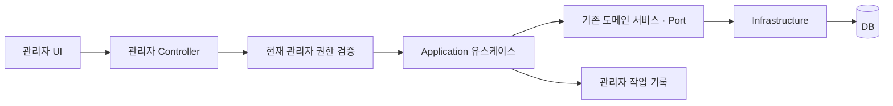

# voice 관리자 UI·백엔드 구현 계획

작성일: 2026-11-01

문서 상태: 단계별 계획. 1차 백엔드 API·V62 migration은 작업 브랜치에 구현했으며 실제 계약은 [관리자 1차 API](../api/admin-phase-one.md), [DB 변경](../database/admin-phase-one.md)을 따른다. 프론트 UI·운영 배포·실제 관리자 지정은 미진행이다. 아래 후속 단계와 설계 제안이 모두 구현됐다는 의미는 아니다.

추가 구현 범위: 사용자의 후속 요청에 따라 공용 ANNOUNCER 콘텐츠의 수동 기준 음성 업로드·연결·대표 지정·미리듣기를 추가했다. [별도 계약](../api/admin-reference-audios.md), V63을 따른다. 아래 3차의 클래스 개정·TTS 운영 전체와는 구분한다.

## 1. 작업 유형과 적용 규칙

- 작업 유형: 관리자 아키텍처, API·DB 설계, 프론트 UI 구성, 개발 계획 문서화.
- `.codex/ai_rule_developer/GLOBAL_RULES.md`: 기존 기능을 재사용하고 변경 범위를 제한한다.
- `ARCHITECTURE_RULES.md`, `SERVICE_LAYER_RULES.md`: controller → application → domain port → infrastructure 경계를 유지한다.
- `API_DESIGN_RULES.md`: `/api` 경로, 인증, DTO, 공통 응답·오류·페이지 계약을 유지한다.
- `DOMAIN_MODEL_RULES.md`, `DOCUMENT_RULE.md`: 저장 모델과 응답을 분리하고 migration·DB·API 문서를 구현과 함께 관리한다.

참고자료는 사용자가 제공한 「대치2동성당 홈페이지 관리자 통합매뉴얼 최종.pdf」다. PDF 파일은 126페이지이며, 아래 페이지 표기는 인쇄된 쪽수가 아닌 PDF 파일 내 페이지 순서다.

| 참고 범위 | 적용할 방식 | voice에서 별도로 결정할 사항 |
| --- | --- | --- |
| PDF 15~18쪽 관리자 관리 | 상태·역할 필터, 확인창, 권한 없는 접근 차단, 마지막 관리자 보호 | 성당의 분과장·단체장 역할이나 가입 승인제를 도입하지 않음 |
| PDF 20~22쪽 홈 관리 | 요약 화면에서 원본 관리 화면으로 이동 | 배너·팝업·홈 위젯 편집기는 초기 범위에서 제외 |
| PDF 95~99쪽 FAQ 관리 | 목록 → 상세 → 편집의 일관된 흐름 | 별도 FAQ 기능·테이블은 초기 범위에서 제외 |
| PDF 101~105쪽 공지 관리 | 검색, 페이지 이동, 공개·고정 설정, 목록 조건 유지 | 현재 sections JSON 구조 사용. 임의 HTML 편집기를 추가하지 않음 |

매뉴얼의 탈퇴 7일 후 영구 삭제, 조직별 권한, 첨부 100MB 등의 정책을 voice에 자동 적용하지 않는다.

## 2. 현재 구현 상태

확인 기준은 작업 공간의 develop 기반 소스와 직전 조회한 `voice.public` DB다. DB는 V58까지 적용된 68개 테이블이었다. 구현 시작 시 최신 develop과 migration 번호를 다시 확인한다.

| 영역 | 현재 있는 것 | 필요한 관리자 기능 |
| --- | --- | --- |
| 권한 | `users.role`의 USER·ADMIN, JWT의 ROLE 권한 | `/api/admin/**` 접근 제어, 현재 계정·권한 재검증 |
| 회원 정보 | `/api/users/me`, 회원 상태·이용등급 조회 | 관리자 전용 회원 검색·상세 조회 |
| 콘텐츠 | 목록·카테고리·기준 음성, 클래스·예문 개정 구조 | 공용 콘텐츠 작성·공개·숨김, 관리용 목록 |
| 공지 | 사용자용 공지 목록·상세, notices의 공개·고정·sections | 작성·수정·공개·숨김 |
| 문의 | 본인 문의 접수·조회, 답변·처리 상태 저장 필드 | 전체 문의 검색, 답변, 상태 전이 |
| 결제 | TEST 주문·서버 검증·취소·환불 및 상태 조회 | 관리자 조회, 별도 권한으로 수행하는 처리 유스케이스 |
| 분석 | 요청·상태·결과·실패·수신·보관 기록 | 운영용 상태 목록과 장애 상세 조회 |
| 작업 이력 | 도메인별 요청·처리 기록 | 관리자의 변경 작업을 추적하는 별도 감사 기록 |

현재 `UserProfileResponseDto`에는 관리자 판단에 사용할 role 필드가 없다. membershipType은 관리 권한의 근거로 사용하지 않는다.

## 3. 구현 범위

### 3.1 1차 구현

관리자 권한 검증, 관리자 접속 정보 조회, 작업 이력, 회원 조회, 공용 콘텐츠 관리, 공지 관리, 문의 답변을 구현한다.

1차에서 회원 정지·탈퇴·복구·권한 변경, 수동 이용권 지급, 결제 취소·환불 실행, 클래스 개정 편집, AI 재분석·상태 변경은 제공하지 않는다. 회원 정보는 조회부터 시작한다.

### 3.2 후속 구현

- 2차: 회원 상태 관리, 결제·환불 조회와 처리, 관리자 역할 변경.
- 3차: 클래스·예문 개정, 기준 음성·TTS 검수, AI 분석 운영 조회, 대시보드 집계.

무료 분석 횟수 예약·차감·복구는 별도 작업이다. 관리자 메뉴를 만들었다고 사용량 제한이 적용되지는 않는다. 분석 결과 강제 성공 처리, PG 상태 수동 덮어쓰기, 결제·학습 기록 일괄 삭제 기능은 제공하지 않는다.

## 4. 프론트 UI 구성

### 4.1 화면 경로와 메뉴

아래는 제안하는 프론트 경로다. 실제 프론트 저장소의 라우팅·컴포넌트 규칙에 맞춰 배치한다.

| 메뉴 | 화면 경로 제안 | 제공 시점 |
| --- | --- | --- |
| 관리자 시작 | `/admin` | 1차. 초기에는 접근 가능한 메뉴 안내, 집계는 3차 |
| 회원 목록·상세 | `/admin/users`, `/admin/users/{userId}` | 1차 |
| 공용 콘텐츠 목록·편집 | `/admin/contents`, `/admin/contents/new`, `/admin/contents/{contentId}` | 1차 |
| 공지 목록·편집 | `/admin/notices`, `/admin/notices/new`, `/admin/notices/{noticeId}` | 1차 |
| 문의 목록·답변 | `/admin/inquiries`, `/admin/inquiries/{inquiryId}` | 1차 |
| 작업 이력 | `/admin/audit-logs` | 1차 |
| 결제·환불 | `/admin/payments`, `/admin/refunds` | 2차 |
| 클래스·예문 / 음성·TTS | `/admin/courses`, `/admin/reference-audios` | 3차 |
| AI 분석 운영 | `/admin/analyses`, `/admin/analyses/{analysisId}` | 3차 |

PC는 왼쪽 메뉴와 본문 영역으로 구성한다. 작은 화면에서는 접이식 메뉴와 가로 스크롤 표 또는 요약 카드를 사용한다. 일반 학습 화면의 하단 메뉴와 관리자 메뉴를 분리한다.

### 4.2 공통 화면 규칙

- 상단: 페이지 제목, 현재 환경(TEST 등), 로그인 관리자, 주 작업 버튼.
- 목록: 상태 탭, 검색 조건, 전체 건수, 표, 페이지 이동.
- 검색·필터·페이지는 URL query에 반영해 상세에서 돌아와도 유지한다.
- 필터 변경 시 page=0으로 초기화한다. 목록 전체를 내려받아 브라우저에서 필터링하지 않는다.
- 저장 중에는 중복 클릭을 막고, 성공 응답 뒤 서버 값을 다시 조회한다.
- 입력 오류, 조회 결과 없음, 권한 없음, 서버 오류를 각각 표시한다.
- 등록·수정은 폼, 공개·숨김 등 짧은 명령은 대상·변경 내용·사유를 확인하는 창을 사용한다.
- 상세 편집의 동시 수정은 마지막 저장으로 조용히 덮어쓰지 않고 충돌 안내·새로고침을 제공한다.
- 서버가 처리 결과를 확정하기 전 성공 표시나 결제 상태 변경을 선반영하지 않는다.

### 4.3 화면별 필드

| 화면 | 목록 | 상세·편집 |
| --- | --- | --- |
| 회원 | ID, 닉네임, 마스킹 이메일, 계정 상태, role, 이용등급, 가입일 | 로그인 제공자·등급 만료일·환경. 비밀번호·해시·토큰 제외 |
| 콘텐츠 | ID, 유형, 제목, 카테고리, 난이도, 상태, 공개 시각 | 제목, 설명, 원문, 학습 초점, 연습 어구, 예상 시간, 공개 설정 |
| 공지 | ID, 제목, 고정·공개 여부, 공개 시각 | 제목, summary, sections, pinned, published, publishedAt |
| 문의 | ID, 분류, 제목, 상태, 접수일 | 본문, 관련 세션 ID, 답변, 상태. 답변 이메일은 필요한 상세 화면에만 표시 |
| 작업 이력 | 시각, 관리자 ID, 작업, 대상 종류·ID, 처리 상태 | 변경된 허용 필드, 사유, 추적 ID. 원고·음성·비밀정보 제외 |

콘텐츠 카테고리는 code와 label을 분리한다. 받침 화면은 `FINAL_CONSONANT`를 저장하고 `받침`을 표시한다. 일반 사용자 facets는 공개 데이터가 있는 카테고리만 반환할 수 있으므로, 관리자 등록 폼은 별도 관리용 카테고리 목록을 사용한다.

## 5. 관리자 인증·권한

### 5.1 접근 기준

```text
기존 로그인
→ GET /api/admin/me
→ 현재 DB의 ACTIVE + role=ADMIN 확인
→ 관리자 메뉴 진입
→ 각 관리자 요청에서도 동일 권한 확인
```

- 관리자도 기존 로그인·갱신 흐름을 재사용한다. 별도 공개 관리자 회원가입은 만들지 않는다.
- `membershipType=admin` 회원은 role이 USER라면 관리자 API에서 403을 받는다.
- SecurityConfig에서 `/api/admin/**`를 일반 authenticated 규칙보다 먼저 제한한다.
- JWT role만으로 허용하지 않는다. 관리자 경계에서 현재 사용자 상태·삭제 여부·role을 다시 확인한다.
- 프론트의 role 값·숨겨진 버튼·직접 입력한 URL을 보안 경계로 취급하지 않는다.
- 관리자 조회 응답과 프론트 프록시는 `Cache-Control: no-store`를 적용한다. 로그아웃·회원 변경 시 관리자 화면 상태를 초기화한다.
- 첫 관리자 지정은 운영자가 대상 계정을 확인한 뒤 수행하는 통제된 bootstrap 작업으로 한다. 전체 회원 승격 migration은 만들지 않는다.
- 2차 역할 회수·정지에서는 로그인 세션·캐시 무효화를 함께 처리한다. 마지막 활성 관리자 제거는 DB 잠금 안에서 차단한다.

### 5.2 관리자 접근 API 제안

```http
GET /api/admin/me
Authorization: Bearer <accessToken>
```

응답 data 제안:

```json
{
  "id": 123,
  "nickname": "운영자",
  "role": "ADMIN"
}
```

이는 신규 제안이며 기존 `/api/users/me` 응답을 임의로 바꾼 계약이 아니다. 1차는 ADMIN 단일 역할을 사용하고 super_admin·분야별 역할 체계는 추가하지 않는다.

## 6. 백엔드 구조

제안하는 배치는 다음과 같다. 관리자 전용 유스케이스와 집계는 admin 모듈에 두고, 실제 도메인 변경은 해당 도메인의 서비스·port를 재사용한다.

```text
admin/
  controller/
    dto/                 # *Dto: 요청·응답·검색 조건
  application/           # 관리자 권한, 조회·명령 조율, 감사 기록
  domain/
    entity/              # 관리자 작업 기록
    model/               # 목록·상세·집계 결과
    port/                # 조회·감사 저장 계약
    type/                # 작업 종류·처리 상태
  infrastructure/        # 조회·감사 port 구현
```



Controller에 DB 수정·결제 판단을 넣지 않는다. 관리자 권한을 추가한다는 이유로 기존 회원 소유권 검사를 제거하지 않는다. 관리자가 다른 회원의 자원을 처리하는 기능은 대상 회원과 수행 관리자를 구분하는 별도 유스케이스로 작성한다.

## 7. 1차 관리자 API 제안

모든 경로는 신규 제안이다. 실제 구현 전 DTO·검증·오류 계약을 확정한다. 인증은 Bearer access token, 권한은 현재 활성 ADMIN이다.

### 7.1 조회

| Method | 경로 | 용도·주요 query |
| --- | --- | --- |
| GET | `/api/admin/me` | 관리자 접근 정보 |
| GET | `/api/admin/users` | 회원 목록: keyword, status, role, page, size |
| GET | `/api/admin/users/{userId}` | 회원 상세 |
| GET | `/api/admin/contents` | 공용 콘텐츠 목록: type, category, status, difficulty, keyword, page, size |
| GET | `/api/admin/contents/{contentId}` | 공용 콘텐츠 상세 |
| GET | `/api/admin/content-categories` | 등록용 분류 목록: type. 공개 콘텐츠 개수와 무관하게 코드·표시명 반환 |
| GET | `/api/admin/notices` | 공지 목록: keyword, published, page, size |
| GET | `/api/admin/notices/{noticeId}` | 비공개 포함 공지 상세 |
| GET | `/api/admin/inquiries` | 문의 목록: status, category, keyword, page, size |
| GET | `/api/admin/inquiries/{inquiryId}` | 문의 상세 |
| GET | `/api/admin/audit-logs` | 작업 이력: actorId, action, targetType, targetId, from, to, page, size |

키워드 검색 범위는 회원의 ID·이메일·닉네임, 콘텐츠·공지의 제목, 문의의 제목으로 제한한다. 관리자 개인 원고·녹음 본문을 전역 검색 대상으로 삼지 않는다. 정렬은 고정된 안정적 순서와 ID 보조 정렬을 사용하고 사용자 입력을 SQL 정렬식에 직접 넣지 않는다.

목록 응답은 기존 `ApiResponse<PageResponse<...>>`의 `items`, `page`, `size`, `totalElements`, `totalPages`, `hasNext` 형태를 따른다. 기본 page=0, size=20, 최대 size=100을 제안한다.

### 7.2 변경

| Method | 경로 | 용도 |
| --- | --- | --- |
| POST | `/api/admin/contents` | 공용 DRAFT 콘텐츠 생성 |
| PATCH | `/api/admin/contents/{contentId}` | DRAFT 편집. version·수정 사유 포함 |
| PATCH | `/api/admin/contents/{contentId}/publication` | 공개·숨김 상태 변경. version·사유 포함 |
| POST | `/api/admin/notices` | 공지 생성 |
| PATCH | `/api/admin/notices/{noticeId}` | 공지 본문·고정·공개 설정 변경. version·사유 포함 |
| PATCH | `/api/admin/inquiries/{inquiryId}/answer` | 답변 작성·수정. version·사유 포함 |
| PATCH | `/api/admin/inquiries/{inquiryId}/status` | 문의 처리 상태 변경. version·사유 포함 |

신규 생성은 201, 조회·수정은 200을 사용한다. 사용자 전용 콘텐츠는 공용 관리 경로에서 조회·수정할 수 없도록 `owner_id IS NULL`을 검증한다.

본문·필수값·길이는 기존 Entity와 도메인 제약을 기준으로 확정한다. 공지는 title 200자·summary 500자, 문의 답변은 기존 answer 4,000자 상한을 유지한다. sections는 현재 허용 타입과 구조를 검증하고 임의 HTML·스크립트·외부 파일 경로를 저장하지 않는다.

오류 계약 제안:

| 상태 | 조건 | UI 처리 |
| --- | --- | --- |
| 400 | 입력·검색 조건 검증 실패 | 해당 필드 안내 |
| 401 | 로그인 만료·세션 무효 | 기존 로그인 복구 |
| 403 | 현재 관리자 권한 없음 | 관리자 접근 종료 |
| 404 | 대상 없음·관리 범위 밖 | 목록 재조회 |
| 409 | 동시 수정·허용하지 않는 상태 전이 | 최신 상태 재조회, 자동 덮어쓰기 금지 |
| 503 | 권한·필수 감사 기록 등 저장소 오류 | 변경 성공으로 표시하지 않고 재조회 |

실제 error code 명칭은 구현 시 ErrorCode와 명세에 추가한다. 이 표는 구현된 오류 목록이 아니다.

## 8. 주요 업무 규칙

### 8.1 공용 콘텐츠

- 생성은 DRAFT로 시작한다. 원문·유형·학습 초점 등 필수값 검증 후 공개한다.
- 한 번 공개한 콘텐츠의 원문은 1차에서 직접 수정하지 않는다. 새 콘텐츠를 생성하고 기존 항목을 숨겨 학습·분석 입력 연결을 보존한다.
- 이미 공개됐다가 숨긴 항목도 원문 잠금을 유지한다. 공개 시각을 임의 초기화해 잠금을 우회하지 못하게 한다.
- 재공개 시 기존 공개 시각·학습 기록을 보존한다. 기준 음성 준비 여부는 실제 연결 상태로 표시한다.
- 기준 음성 생성은 기존 TTS outbox 흐름을 사용한다. 콘텐츠 저장 성공과 음성 생성 완료를 구분한다.
- 콘텐츠 수정·공개 변경 시 기존 상세·추천·목록 관련 캐시 중 실제 사용하는 캐시를 확인해 무효화한다.
- 1차에서는 물리 삭제·대량 변경·카테고리 코드 자유 입력을 제공하지 않는다.

### 8.2 공지

- 기존 title·summary·sections·pinned·published·publishedAt 구조를 사용한다.
- 미리보기와 실제 사용자 화면이 같은 sections 렌더링 규칙을 사용한다.
- 비공개와 미래 공개 시각의 항목은 관리자에게 보이되 사용자 조회 조건에서는 제외한다.
- 배너·팝업·이미지 첨부 기능은 1차 범위에 포함하지 않는다.

### 8.3 문의

- 기본 흐름은 RECEIVED → IN_PROGRESS → ANSWERED → CLOSED다.
- 답변 저장 시 ANSWERED로 전환하고 answeredAt을 서버 시각으로 기록한다. 빈 답변으로 ANSWERED 전환을 허용하지 않는다.
- ANSWERED 상태의 답변 수정은 허용하되 이전 작업을 감사 기록으로 추적한다. CLOSED는 1차에서 다시 열지 않는다.
- 사용자 문의 목록·상세에 저장한 답변이 반영돼야 한다. 자동 이메일·푸시 발송은 이번 범위에 포함하지 않는다.

### 8.4 결제·환불: 2차

- 초기 관리 대상은 현재 구현된 TEST 결제다. 실결제·부분 환불·자동 구독 기능으로 확장됐다고 표시하지 않는다.
- 기존 환불 신청은 담당자 승인 대기 업무와 같은 의미라고 가정하지 않는다. 실제 PaymentRefundService 상태 전이를 기준으로 화면을 설계한다.
- 관리자 실행 경로에서 actor와 주문 소유자를 구분하고 PG adapter·검증·멱등·복구 흐름을 재사용한다.
- PG 호출 중 DB 잠금을 오래 유지하지 않는다. 요청 시도·PG 처리·결과 확인을 기록하고 네트워크 실패 시 주문을 재조회한다.
- 주문 상태를 직접 PAID·CANCELLED로 저장하거나, 결제 검증 없이 paid 등급을 지급하는 기능은 만들지 않는다.
- 관리자 요청 자체의 재시도 식별과 외부 PG 중복 처리 방지는 각각 검증한다.

### 8.5 분석·TTS: 3차

- AI 목록은 분석 ID·세션 ID·상태·실패 코드·접수/종료 시각으로 검색한다.
- 상세는 실행 ID·프로필·heartbeat·결과 수신·저장 여부를 표시한다. raw payload·토큰·서명 URL·사용자 음성을 기본 노출하지 않는다.
- AI 실행 실패와 결과 저장 실패, 아직 처리 중인 상태를 구분한다.
- 실행 중인 작업을 관리자 UI에서 강제로 COMPLETED로 바꾸지 않는다.
- 운영 재시도와 원본 음성 접근이 필요하면 권한·동의·재접수·사용 횟수 정책을 별도 확정한다. 초기 운영 화면은 조회만 제공한다.

## 9. DB 변경 계획

기존 68개 테이블을 관리자 메뉴 단위로 복제하지 않는다. 현재 테이블을 도메인 규칙에 맞게 조회·변경하고 관리자 작업 추적에 필요한 부분만 추가한다.

### 9.1 관리자 작업 이력 테이블 제안

신규 `admin_audit_logs`를 제안한다. migration 번호와 최종 이름은 구현 시작 시 확정한다.

| 필드 | 목적 |
| --- | --- |
| id | 작업 식별자 |
| actor_user_id | 수행 관리자 |
| action | 콘텐츠 공개·문의 답변 등 서버 정의 작업 |
| target_type / target_id | 변경 대상. 다형 대상 ID는 문자열로 표현 |
| reason | 관리자 입력 사유 |
| changed_fields | 허용 필드의 변경 요약 JSON |
| outcome | 후속 외부 처리 도입 시 요청·성공·실패 등을 구분 |
| correlation_id | 서버 로그·처리 시도 추적 |
| created_at | 서버 기록 시각 |

- 비밀번호·토큰·원고·음성·문의 본문·답변 전문·전체 요청 JSON을 감사 기록에 복사하지 않는다. 예: answer 변경은 변경 사실과 길이 등 최소 정보만 남긴다.
- 1차 DB 변경은 업무 수정과 성공 감사 기록을 같은 트랜잭션으로 저장한다. 감사 저장 실패 시 업무 변경도 롤백한다.
- 결제 등 외부 작업은 요청 기록과 후속 결과 기록을 연결한다. PG 성공 후 감사 실패가 발생했다고 환불 요청을 무조건 재전송하지 않는다.
- 관리 UI에서 감사 기록 수정·삭제를 제공하지 않는다. 보존기간·열람 범위는 운영 정책으로 확정한다.
- 인덱스는 시각+ID, 대상+시각 등 실제 조회 조건에 맞춰 설계한다.

### 9.2 기존 테이블의 동시 수정 방지

1차 수정 대상인 `practice_contents`, `notices`, `inquiries`에 version 필드를 추가하고 JPA 낙관적 잠금과 연결하는 안을 제안한다. 관리자 상세 응답과 변경 요청에 version을 포함한다.

기존 사용자 접수·분석·TTS 처리에서 같은 Entity를 갱신하는 경로도 영향을 받으므로 통합 테스트한다. 기존 필드를 재사용해 안전하게 동일 기능을 구현할 수 있는지 migration 작성 전에 검토한다. 신규 version을 추가한다면 기본값·기존 행 backfill·원시 SQL 갱신 경로까지 명시한다.

## 10. 프론트·백엔드 협업 방식

| 작업 | 프론트 | 백엔드 |
| --- | --- | --- |
| 권한 | /admin/me 결과로 진입·메뉴 표시, 401·403 처리 | 현재 DB 권한·세션 검증, bootstrap 절차 |
| 목록 | URL 기반 검색·필터·페이지, 로딩·빈 상태 | 조건별 조회·정렬·페이지, 마스킹 DTO |
| 편집 | 필수값 안내·미리보기·중복 클릭 방지 | 같은 입력 재검증·소유 범위·상태 전이·동시 수정 |
| 변경 | version·사유 전달, 응답 후 재조회 | 업무 처리·감사 기록의 일관성 |
| 콘텐츠 | code 전송·label 표시, 공개/음성 상태 구분 | 카테고리 검증·캐시 무효화·기존 TTS 연동 |
| 문의 | 답변 편집·처리 상태 표시 | 답변·상태·답변 시각 저장 |
| 운영 오류 | 재조회와 재실행 버튼을 구분 | 오류 코드·안전한 복구 절차 제공 |

먼저 1차 DTO·에러·페이지 계약과 최소 테스트 데이터를 확정한다. 프론트는 합의된 계약의 mock으로 화면을 만들 수 있지만 실제 관리자 검증을 우회하는 mock 권한을 배포하지 않는다. 토큰은 기존 인증 저장 방식과 프록시를 재사용하고 서버 비밀키를 클라이언트 환경변수에 넣지 않는다.

## 11. 구현 순서와 PR 분리

각 작업은 최신 develop에서 작은 범위의 브랜치로 진행한다. 아래 순서가 의존 관계이며 기간을 확정한 일정은 아니다.

| 순서 | 백엔드 결과물 | 프론트 결과물 | 완료 조건 |
| --- | --- | --- | --- |
| 1 | 관리자 guard, /admin/me, 감사 저장 기반·migration | 관리자 레이아웃·접근 분기·오류 화면 | USER·테스트 admin 차단, 실제 ADMIN만 접근 |
| 2 | 회원 조회, 카테고리·콘텐츠 목록·작성·편집·공개 | 회원 목록·상세, 콘텐츠 목록·폼·미리보기 | 비공개 조회와 사용자 목록 노출 조건 분리 |
| 3 | 공지 CRUD 중 생성·수정·숨김, 문의 답변·상태 | 공지 폼·문의 답변·작업 이력 조회 | 사용자 화면에서 공지·답변 반영 확인 |
| 4 | 회원 상태·권한, TEST 결제·환불 관리 | 대상 확인·사유·처리 상태 화면 | 권한 회수·세션 무효화, PG 중복 방지 |
| 5 | 분석·TTS 운영 조회, 클래스 개정, 집계 | 운영 상태 목록·대시보드 | 기존 분석·클래스·결제 회귀 검증 |

PR 제목 예시:

- `[FEAT]: 관리자 접근 제어 및 작업 이력 기반 구현`
- `[FEAT]: 관리자 회원 조회 및 공용 콘텐츠 관리 구현`
- `[FEAT]: 관리자 공지 관리 및 문의 답변 구현`

프론트·백엔드 저장소의 PR을 연결하고, 각 PR은 해당 단계의 구현과 관련 문서만 포함한다. 생성된 SQL이나 문서만으로 관리자 기능 배포가 완료됐다고 표시하지 않는다.

## 12. 검증·배포 기준

### 보안

- 비로그인 401, USER 403, `membershipType=admin`+USER 403, 활성 ADMIN 허용.
- 권한 회수·정지·탈퇴 후 기존 토큰과 세션으로 관리자 API를 사용할 수 없음.
- 다른 대상 ID·private 콘텐츠 ID를 직접 입력해 범위를 우회할 수 없음.
- 응답·감사·로그에 비밀정보나 비밀번호 해시가 없음.
- 2차에서 마지막 관리자 동시 강등·정지 시도도 차단됨.

### 기능·데이터

- 콘텐츠 DRAFT 작성→편집→공개→사용자 목록 확인→숨김 흐름.
- 한 번 공개된 원문 편집 차단과 기존 세션·분석 연결 보존.
- 공개된 콘텐츠의 카테고리가 code로 저장되고 사용자 facets에는 label이 표시됨.
- 문의 답변 저장과 사용자 본인 조회 일치, CLOSED 변경 차단.
- 공지 sections 검증과 공개 시각·고정·숨김 조건 일치.
- 동시 수정은 409, 감사 저장 실패는 업무 롤백.
- TTS·분석 등 기존 원시 SQL·비동기 갱신과 version 충돌 처리 검증.

### 배포

1. TEST 환경에서 migration과 권한 차단부터 검증한다.
2. 승인된 관리자 1개 계정을 통제된 절차로 지정하고 USER 계정도 함께 준비한다.
3. 백엔드 배포 후 Swagger·계약 검증, 프론트 배포 후 실제 UI 전체 흐름을 검증한다.
4. 기존 로그인·문장 조회·클래스 녹음·분석·결제 API가 유지되는지 확인한다.
5. 관리자 UI를 숨기는 조치와 API 차단을 함께 준비한다. 장애 시 감사·결제 이력을 삭제하거나 migration 파일을 수정해 되돌리지 않는다.

구현 PR마다 `docs/api/endpoints.md`, `docs/api/specification.md`, 관련 DB·아키텍처 문서를 실제 구현에 맞춰 갱신한다. 이 계획서의 신규 API를 구현 전에 기존 API 목록에 구현 완료로 등록하지 않는다.

## 13. 착수 전 확정할 항목

- 첫 실제 관리자 계정과 권한 부여 담당자.
- 1차 메뉴 범위와 회원 정보 마스킹 범위.
- 콘텐츠 원문 수정 제한 및 새 항목 생성 방식에 대한 운영자 합의.
- 감사 기록 보존기간·사유 필수 기준.
- 2차 TEST 환불 처리 권한과 기존 자동 처리 흐름의 차이.

세부 정책이 미확정인 회원 강제 탈퇴·관리자 승격·실결제·개인 음성 열람은 1차 구현을 막는 전제조건으로 두지 않고 후속 범위에서 확정한다.


## 관리자 알림·회원 기록 추가 구현

전체·개별 앱 내 알림, 수동 요금제 안내, 기간 지정 전체 팝업, 회원별 기록·분석 UUID 조회를 추가했다. API 12개(관리자11·사용자1), V64 신규 테이블3개이며 프론트는 수정하지 않았다. [API 계약](../api/admin-communications-and-members.md), [DB 구조](../database/admin-communications.md)를 따른다. 웹 푸시·결제 자동 알림·회원 PK UUID 전환은 포함하지 않는다.
